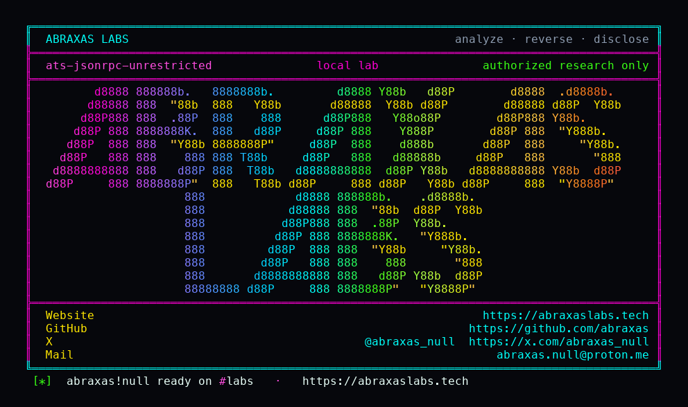

<p align="center">
  
</p>

<p align="center">
  <a href="https://abraxaslabs.tech"><strong>abraxaslabs.tech</strong></a>
  &nbsp;·&nbsp;
  <a href="https://github.com/abraxas">github.com/abraxas</a>
  &nbsp;·&nbsp;
  <a href="https://x.com/abraxas_null">@abraxas_null</a>
  &nbsp;·&nbsp;
  <a href="mailto:abraxas.null@proton.me">abraxas.null@proton.me</a>
  &nbsp;·&nbsp;
  <a href="https://github.com/abraxas/ats-jsonrpc-unrestricted">ats-jsonrpc-unrestricted</a>
</p>
<p align="center">
  Write-up: <a href="https://abraxaslabs.tech/research/ats-jsonrpc-unrestricted"><strong>https://abraxaslabs.tech/research/ats-jsonrpc-unrestricted</strong></a>
</p>


# ats-jsonrpc-unrestricted

**Class:** Privilege leftover (recon)
**Reach:** Local

**Apache Traffic Server** `10.2.0` (`b1df7334`) - Apache Software Foundation

JSON-RPC unix socket defaults to `restricted_api` false. Shipped `jsonrpc.yaml` is comments only, so the C++ initializer wins. Linux SO_PEERCRED bind mode is **0777**. Any local uid that can reach the rundir inode connects with no token and dumps live records (including SSL **key paths**) plus connection-tracker 5-tuples. Writes stay behind SO_PEERCRED (`euid == 0` or ATS euid). Docs table says `true` / `0700`; code and the commented example are `false` / `0777`.

This is not CVE-2026-58159 (HTTP UDS listener ACL). There is no TCP/HTTP JSON-RPC. Plugin load and config write stay denied for a foreign uid.

| | |
|---|---|
| ID | no CVE yet |
| Class | **Privilege leftover** (recon) |
| Reach | **Local** (unprivileged uid on the ATS host) |
| CWE | [CWE-276](https://cwe.mitre.org/data/definitions/276.html), [CWE-284](https://cwe.mitre.org/data/definitions/284.html) |
| CVSS | **High: 7.1** `CVSS:3.1/AV:L/AC:L/PR:L/UI:N/S:U/C:H/I:N/A:N` |
| Product | [Apache Traffic Server](https://github.com/apache/trafficserver) |
| Affected | **10.2.0** (`b1df7334b39a878971c376da849e8da4984918b6`) default JSON-RPC unix |
| Auth | none on unrestricted methods. Local filesystem reach of rundir. |
| License | [GNU Affero GPL v3.0](LICENSE) |
| Lab | `127.0.0.1:18720` only. Image `ats-10.2.0-lab:local`. |

I pinned tag [10.2.0](https://github.com/apache/trafficserver/releases/tag/10.2.0), commit [`b1df7334b39a878971c376da849e8da4984918b6`](https://github.com/apache/trafficserver/commit/b1df7334b39a878971c376da849e8da4984918b6). Source-built image.

## What an attacker can do

Local uid on the ATS host (not root, not ATS euid). RPC enabled. JSON-RPC unix on. Typical rundir `0755` ATS-owned. Socket `$RUNTIMEDIR/jsonrpc20.sock`.

| Method | Sink | Privilege |
|---|---|---|
| `admin_lookup_records` as uid 10000 on 0777 `jsonrpc20.sock` | unrestricted JSON-RPC ([`RpcAdminPubHandlers.cc`](https://github.com/apache/trafficserver/blob/b1df7334b39a878971c376da849e8da4984918b6/src/traffic_server/RpcAdminPubHandlers.cc)) | **Recon (lab-proven):** live `proxy.config.proxy_name=ATS-JSONRPC-UNRESTRICTED-WITNESS`, SSL key **paths** `etc/trafficserver`, `proxy.config.admin.user_id=nobody`. Key bytes are not in records. |
| `get_connection_tracker_info` | same socket | **Recon (lab-proven):** inbound/outbound tracker tables (empty under no load). |
| `get_server_status`, `admin_host_get_status`, `admin_storage_get_device_status`, `filemanager.get_files_registry` | same unrestricted bit | **Recon (inferred):** drain state, host markdown, cache disk paths, absolute config paths. |
| `admin_config_set_records` as uid 10000 | SO_PEERCRED restricted | **Integrity: closed (lab-proven).** JSON-RPC error 10 Unauthorized, `Denied privileged API access for uid=10000`. Witness record unchanged. |
| drain / cache clear / storage offline | restricted methods | **Availability: closed** for a foreign uid (source). |

**Lab-proven vs inferred:** 0777 socket, uid 10000 lookup of proxy_name / SSL key paths, tracker tables, write denied, TCP JSON-RPC absent: lab. Other unrestricted read methods: inferred from the same gate.

**Requires:** local uid on the ATS host. JSON-RPC unix on (default). Linux SO_PEERCRED so unrestricted bind is 0777. Rundir reachable (typical `0755`).

## Adjacent surface that stays closed

| Surface | Lab |
|---|---|
| `admin_config_set_records` as uid 10000 | Unauthorized; witness record unchanged |
| TCP / HTTP JSON-RPC | absent; HTTP 8080 / 18080 only |
| Plugin `.so` load via RPC | SO_PEERCRED |
| Same-uid `traffic_ctl` | intended admin |
| Atomic umask+bind when `restricted_api` is true | 0700, CHANGELOG fix held |
| CVE-2026-58159 HTTP UDS listener ACL | not this socket |

## How I found it

RPC is on unless `rpc.enabled: false`. Only `CommType::UNIX` exists. Shipped `jsonrpc.yaml.default` is comments only. YAML decode only writes `restrictedAccessApi` when the key is present. Otherwise:

```cpp
bool restrictedAccessApi{
  NON_RESTRICTED_API}; // ... 0700(default) or 0777
```

`NON_RESTRICTED_API` is `false` ([`IPCSocketServer.h:128-129`](https://github.com/apache/trafficserver/blob/b1df7334b39a878971c376da849e8da4984918b6/include/mgmt/rpc/server/IPCSocketServer.h#L128-L129)). Comment says 0700 is default. Initializer is the unrestricted constant.

Bind ([`IPCSocketServer.cc:310-342`](https://github.com/apache/trafficserver/blob/b1df7334b39a878971c376da849e8da4984918b6/src/mgmt/rpc/server/IPCSocketServer.cc#L310-L342)): `restricted_api` false plus SO_PEERCRED -> mode **0777**. Docs table last sentence says **true** by default. Code and the commented example follow false.

Wrong turns: treating docs `true` as the default; calling this RCE (writes denied); treating CVE-2026-58159 as covering mgmt JSON-RPC; looking for a TCP leftover of old traffic_manager XMLRPC.

Theatre: a write as uid 10000. The oracle is a planted `proxy_name` plus SSL key path strings, then a denied set.

## Lab

```bash
python3 ats-jsonrpc-unrestricted-Abraxas-Labs.py
```

or

```bash
cd lab
./run.sh
```

Loopback `127.0.0.1:18720`. Compose project `ats-jsonrpc-unrestricted`. Image `ats-10.2.0-lab:local`. Lab uid 10000. Socket mode 0777. Witness `ATS-JSONRPC-UNRESTRICTED-WITNESS`. Last line:

```
SUCCESS ats-jsonrpc-unrestricted how=uds-0777-unrestricted-jsonrpc uid=10000 sock-mode=0777 lookup-proxy_name=ATS-JSONRPC-UNRESTRICTED-WITNESS ssl-key-path=etc/trafficserver tracker=ok write=unauthorized tcp-jsonrpc=absent ATS-JSONRPC-UNRESTRICTED-WITNESS
```

## The fix

Default `restricted_api` to true and bind 0700, matching the docs table. Align the commented `jsonrpc.yaml` example. Keep unrestricted reads behind an explicit opt-in. Writes already require SO_PEERCRED; do not open them.

## References

- [github.com/apache/trafficserver](https://github.com/apache/trafficserver) tag [10.2.0](https://github.com/apache/trafficserver/releases/tag/10.2.0) (`b1df7334b39a878971c376da849e8da4984918b6`)
- [`IPCSocketServer.h`](https://github.com/apache/trafficserver/blob/b1df7334b39a878971c376da849e8da4984918b6/include/mgmt/rpc/server/IPCSocketServer.h) `restrictedAccessApi`
- [`IPCSocketServer.cc`](https://github.com/apache/trafficserver/blob/b1df7334b39a878971c376da849e8da4984918b6/src/mgmt/rpc/server/IPCSocketServer.cc) bind mode 0777
- [`RpcAdminPubHandlers.cc`](https://github.com/apache/trafficserver/blob/b1df7334b39a878971c376da849e8da4984918b6/src/traffic_server/RpcAdminPubHandlers.cc)
- [`jsonrpc.yaml.default`](https://github.com/apache/trafficserver/blob/b1df7334b39a878971c376da849e8da4984918b6/configs/jsonrpc.yaml.default)
- [CWE-276](https://cwe.mitre.org/data/definitions/276.html) · [CWE-284](https://cwe.mitre.org/data/definitions/284.html)
